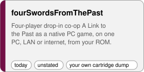
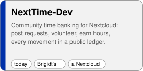
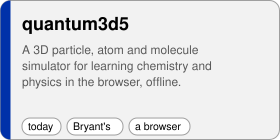
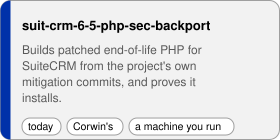
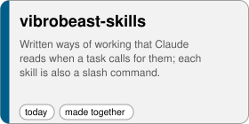
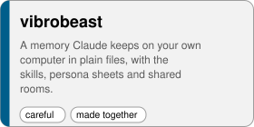
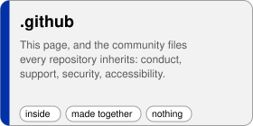

<!--
SPDX-FileCopyrightText: 2026 Corwin Brust <corwin@bru.st>, Bryant Frankford <nathanielfrankford@gmail.com> and Contributors
SPDX-License-Identifier: CC-BY-SA-4.0
This page is built: the part between the two pf1bd lines comes from profile/catalog.tsv (tools/pf1bd writes it,
tests/pf1bd-check.sh reads it back). Edit the catalog or front.head.md / front.tail.md in the members' repository that holds them.
-->

# inputloop

Small free software for working with an AI assistant on your own computer, games you play from your own
cartridge, a simulator for learning chemistry, and patched PHP for old business software. The memory is kept in
plain files you can read; the ways of working are written down; the rooms where people and agents meet run on
your machines. Everything here runs where you put it and sends nothing unless you open a door.

Each tile below links to the thing itself, or to the one page that shows it best. The line under a tile says
what you would do with it, what you bring, whose work it is, and whether a stranger can use it today. The
same words head the sections further down, so you can find a thing by any of them.

<!-- pf1bd: from here to the matching end line, this page is written by tools/pf1bd from catalog.tsv; edit the catalog, the facets or the head and tail files, not this -->

## What you can get today

<table>
<tr>
<td valign="top" width="300"><a href="https://github.com/inputloop/fourSwordsFromThePast/blob/HEAD/docs/screenshots/title.png"><picture><source media="(prefers-color-scheme: dark)" srcset="tiles/fourSwordsFromThePast-dark.svg"></picture></a> <a href="#do-play">play a game</a> · bring <a href="#bring-your-rom">your own cartridge dump</a> · <a href="#whose-unstated">credit not yet written in its README</a> · <a href="#state-today">use it today</a></td>
<td valign="top" width="300"><a href="https://github.com/inputloop/NextTime-Dev/blob/HEAD/demo/index.html"><picture><source media="(prefers-color-scheme: dark)" srcset="tiles/NextTime-Dev-dark.svg"></picture></a> <a href="#do-run">run it on a machine you keep</a> · bring <a href="#bring-nextcloud">a Nextcloud</a> · <a href="#whose-brigidt">Brigidt&#x27;s</a> · <a href="#state-today">use it today</a></td>
<td valign="top" width="300"><a href="https://github.com/inputloop/quantum3d5/blob/HEAD/index.html"><picture><source media="(prefers-color-scheme: dark)" srcset="tiles/quantum3d5-dark.svg"></picture></a> <a href="#do-learn">learn from it</a> · bring <a href="#bring-a-browser">a browser</a> · <a href="#whose-bryant">Bryant&#x27;s</a> · <a href="#state-today">use it today</a></td>
</tr>
<tr>
<td valign="top" width="300"><a href="https://github.com/inputloop/suit-crm-6-5-php-sec-backport/blob/HEAD/RUNBOOK.md"><picture><source media="(prefers-color-scheme: dark)" srcset="tiles/suit-crm-6-5-php-sec-backport-dark.svg"></picture></a> <a href="#do-build">build or run a program</a> · <a href="#do-check">check and review</a> · bring <a href="#bring-a-host">a machine you run</a> · <a href="#whose-corwin">Corwin&#x27;s</a> · <a href="#state-today">use it today</a></td>
<td valign="top" width="300"><a href="https://github.com/inputloop/vibrobeast-skills/blob/HEAD/skills"><picture><source media="(prefers-color-scheme: dark)" srcset="tiles/vibrobeast-skills-dark.svg"></picture></a> <a href="#do-run">run it on a machine you keep</a> · bring <a href="#bring-claude">Claude Desktop or Claude Code</a> · <a href="#whose-shared">made together</a> · <a href="#state-today">use it today</a></td>
</tr>
</table>

## Works for its makers, not yet reviewed by anyone else

<table>
<tr>
<td valign="top" width="300"><a href="https://github.com/inputloop/vibrobeast/blob/HEAD/SKILLS.md"><picture><source media="(prefers-color-scheme: dark)" srcset="tiles/vibrobeast-dark.svg"></picture></a> <a href="#do-run">run it on a machine you keep</a> · bring <a href="#bring-claude">Claude Desktop or Claude Code</a> · <a href="#whose-shared">made together</a> · <a href="#state-careful">works for its makers, not yet reviewed by anyone else</a></td>
</tr>
</table>

## The shop's own tooling and notes

<table>
<tr>
<td valign="top" width="300"><a href="https://github.com/inputloop/.github/blob/HEAD/profile/README.md"><picture><source media="(prefers-color-scheme: dark)" srcset="tiles/.github-dark.svg"></picture></a> <a href="#do-read">read it</a> · bring <a href="#bring-nothing">nothing</a> · <a href="#whose-shared">made together</a> · <a href="#state-inside">the shop&#x27;s own tooling and notes</a></td>
</tr>
</table>

## Find a thing by what you would do with it

One repository sits under several words. Open a word to see what is there; every line says what you bring and whose work it is.

**Do:** [play](#do-play) · [build](#do-build) · [run](#do-run) · [read](#do-read) · [learn](#do-learn) · [check](#do-check)  
**Bring:** [nothing](#bring-nothing) · [your-rom](#bring-your-rom) · [nextcloud](#bring-nextcloud) · [claude](#bring-claude) · [a-host](#bring-a-host) · [a-browser](#bring-a-browser)  
**Whose:** [bryant](#whose-bryant) · [corwin](#whose-corwin) · [brigidt](#whose-brigidt) · [shared](#whose-shared) · [unstated](#whose-unstated)  
**State:** [today](#state-today) · [careful](#state-careful) · [inside](#state-inside)  

### By what you would do

<b>play</b> · play a game · 1

#### do: play

- **[fourSwordsFromThePast](https://github.com/inputloop/fourSwordsFromThePast/blob/HEAD/docs/screenshots/title.png)**: Four-player drop-in co-op A Link to the Past as a native PC game, on one PC, LAN or internet, from your ROM. · [play a game](#do-play) · bring [your own cartridge dump](#bring-your-rom) · [credit not yet written in its README](#whose-unstated) · [use it today](#state-today)

<b>build</b> · build or run a program · 1

#### do: build

- **[suit-crm-6-5-php-sec-backport](https://github.com/inputloop/suit-crm-6-5-php-sec-backport/blob/HEAD/RUNBOOK.md)**: Builds patched end-of-life PHP for SuiteCRM from the project's own mitigation commits, and proves it installs. · [build or run a program](#do-build) · [check and review](#do-check) · bring [a machine you run](#bring-a-host) · [Corwin's](#whose-corwin) · [use it today](#state-today)

<b>run</b> · run it on a machine you keep · 3

#### do: run

- **[NextTime-Dev](https://github.com/inputloop/NextTime-Dev/blob/HEAD/demo/index.html)**: Community time banking for Nextcloud: post requests, volunteer, earn hours, every movement in a public ledger. · [run it on a machine you keep](#do-run) · bring [a Nextcloud](#bring-nextcloud) · [Brigidt's](#whose-brigidt) · [use it today](#state-today)
- **[vibrobeast](https://github.com/inputloop/vibrobeast/blob/HEAD/SKILLS.md)**: A memory Claude keeps on your own computer in plain files, with the skills, persona sheets and shared rooms. · [run it on a machine you keep](#do-run) · bring [Claude Desktop or Claude Code](#bring-claude) · [made together](#whose-shared) · [works for its makers, not yet reviewed by anyone else](#state-careful)
- **[vibrobeast-skills](https://github.com/inputloop/vibrobeast-skills/blob/HEAD/skills)**: Written ways of working that Claude reads when a task calls for them; each skill is also a slash command. · [run it on a machine you keep](#do-run) · bring [Claude Desktop or Claude Code](#bring-claude) · [made together](#whose-shared) · [use it today](#state-today)

<b>read</b> · read it · 1

#### do: read

- **[.github](https://github.com/inputloop/.github/blob/HEAD/profile/README.md)**: This page, and the community files every repository inherits: conduct, support, security, accessibility. · [read it](#do-read) · bring [nothing](#bring-nothing) · [made together](#whose-shared) · [the shop's own tooling and notes](#state-inside)

<b>learn</b> · learn from it · 1

#### do: learn

- **[quantum3d5](https://github.com/inputloop/quantum3d5/blob/HEAD/index.html)**: A 3D particle, atom and molecule simulator for learning chemistry and physics in the browser, offline. · [learn from it](#do-learn) · bring [a browser](#bring-a-browser) · [Bryant's](#whose-bryant) · [use it today](#state-today)

<b>check</b> · check and review · 1

#### do: check

- **[suit-crm-6-5-php-sec-backport](https://github.com/inputloop/suit-crm-6-5-php-sec-backport/blob/HEAD/RUNBOOK.md)**: Builds patched end-of-life PHP for SuiteCRM from the project's own mitigation commits, and proves it installs. · [build or run a program](#do-build) · [check and review](#do-check) · bring [a machine you run](#bring-a-host) · [Corwin's](#whose-corwin) · [use it today](#state-today)

### By what you bring

<b>nothing</b> · nothing · 1

#### bring: nothing

- **[.github](https://github.com/inputloop/.github/blob/HEAD/profile/README.md)**: This page, and the community files every repository inherits: conduct, support, security, accessibility. · [read it](#do-read) · bring [nothing](#bring-nothing) · [made together](#whose-shared) · [the shop's own tooling and notes](#state-inside)

<b>your-rom</b> · your own cartridge dump · 1

#### bring: your-rom

- **[fourSwordsFromThePast](https://github.com/inputloop/fourSwordsFromThePast/blob/HEAD/docs/screenshots/title.png)**: Four-player drop-in co-op A Link to the Past as a native PC game, on one PC, LAN or internet, from your ROM. · [play a game](#do-play) · bring [your own cartridge dump](#bring-your-rom) · [credit not yet written in its README](#whose-unstated) · [use it today](#state-today)

<b>nextcloud</b> · a Nextcloud · 1

#### bring: nextcloud

- **[NextTime-Dev](https://github.com/inputloop/NextTime-Dev/blob/HEAD/demo/index.html)**: Community time banking for Nextcloud: post requests, volunteer, earn hours, every movement in a public ledger. · [run it on a machine you keep](#do-run) · bring [a Nextcloud](#bring-nextcloud) · [Brigidt's](#whose-brigidt) · [use it today](#state-today)

<b>claude</b> · Claude Desktop or Claude Code · 2

#### bring: claude

- **[vibrobeast](https://github.com/inputloop/vibrobeast/blob/HEAD/SKILLS.md)**: A memory Claude keeps on your own computer in plain files, with the skills, persona sheets and shared rooms. · [run it on a machine you keep](#do-run) · bring [Claude Desktop or Claude Code](#bring-claude) · [made together](#whose-shared) · [works for its makers, not yet reviewed by anyone else](#state-careful)
- **[vibrobeast-skills](https://github.com/inputloop/vibrobeast-skills/blob/HEAD/skills)**: Written ways of working that Claude reads when a task calls for them; each skill is also a slash command. · [run it on a machine you keep](#do-run) · bring [Claude Desktop or Claude Code](#bring-claude) · [made together](#whose-shared) · [use it today](#state-today)

<b>a-host</b> · a machine you run · 1

#### bring: a-host

- **[suit-crm-6-5-php-sec-backport](https://github.com/inputloop/suit-crm-6-5-php-sec-backport/blob/HEAD/RUNBOOK.md)**: Builds patched end-of-life PHP for SuiteCRM from the project's own mitigation commits, and proves it installs. · [build or run a program](#do-build) · [check and review](#do-check) · bring [a machine you run](#bring-a-host) · [Corwin's](#whose-corwin) · [use it today](#state-today)

<b>a-browser</b> · a browser · 1

#### bring: a-browser

- **[quantum3d5](https://github.com/inputloop/quantum3d5/blob/HEAD/index.html)**: A 3D particle, atom and molecule simulator for learning chemistry and physics in the browser, offline. · [learn from it](#do-learn) · bring [a browser](#bring-a-browser) · [Bryant's](#whose-bryant) · [use it today](#state-today)

### By whose work it is

<b>bryant</b> · Bryant&#x27;s · 1

#### whose: bryant

- **[quantum3d5](https://github.com/inputloop/quantum3d5/blob/HEAD/index.html)**: A 3D particle, atom and molecule simulator for learning chemistry and physics in the browser, offline. · [learn from it](#do-learn) · bring [a browser](#bring-a-browser) · [Bryant's](#whose-bryant) · [use it today](#state-today)

<b>corwin</b> · Corwin&#x27;s · 1

#### whose: corwin

- **[suit-crm-6-5-php-sec-backport](https://github.com/inputloop/suit-crm-6-5-php-sec-backport/blob/HEAD/RUNBOOK.md)**: Builds patched end-of-life PHP for SuiteCRM from the project's own mitigation commits, and proves it installs. · [build or run a program](#do-build) · [check and review](#do-check) · bring [a machine you run](#bring-a-host) · [Corwin's](#whose-corwin) · [use it today](#state-today)

<b>brigidt</b> · Brigidt&#x27;s · 1

#### whose: brigidt

- **[NextTime-Dev](https://github.com/inputloop/NextTime-Dev/blob/HEAD/demo/index.html)**: Community time banking for Nextcloud: post requests, volunteer, earn hours, every movement in a public ledger. · [run it on a machine you keep](#do-run) · bring [a Nextcloud](#bring-nextcloud) · [Brigidt's](#whose-brigidt) · [use it today](#state-today)

<b>shared</b> · made together · 3

#### whose: shared

- **[.github](https://github.com/inputloop/.github/blob/HEAD/profile/README.md)**: This page, and the community files every repository inherits: conduct, support, security, accessibility. · [read it](#do-read) · bring [nothing](#bring-nothing) · [made together](#whose-shared) · [the shop's own tooling and notes](#state-inside)
- **[vibrobeast](https://github.com/inputloop/vibrobeast/blob/HEAD/SKILLS.md)**: A memory Claude keeps on your own computer in plain files, with the skills, persona sheets and shared rooms. · [run it on a machine you keep](#do-run) · bring [Claude Desktop or Claude Code](#bring-claude) · [made together](#whose-shared) · [works for its makers, not yet reviewed by anyone else](#state-careful)
- **[vibrobeast-skills](https://github.com/inputloop/vibrobeast-skills/blob/HEAD/skills)**: Written ways of working that Claude reads when a task calls for them; each skill is also a slash command. · [run it on a machine you keep](#do-run) · bring [Claude Desktop or Claude Code](#bring-claude) · [made together](#whose-shared) · [use it today](#state-today)

<b>unstated</b> · credit not yet written in its README · 1

#### whose: unstated

- **[fourSwordsFromThePast](https://github.com/inputloop/fourSwordsFromThePast/blob/HEAD/docs/screenshots/title.png)**: Four-player drop-in co-op A Link to the Past as a native PC game, on one PC, LAN or internet, from your ROM. · [play a game](#do-play) · bring [your own cartridge dump](#bring-your-rom) · [credit not yet written in its README](#whose-unstated) · [use it today](#state-today)

### By where it stands

<b>today</b> · use it today · 5

#### state: today

- **[fourSwordsFromThePast](https://github.com/inputloop/fourSwordsFromThePast/blob/HEAD/docs/screenshots/title.png)**: Four-player drop-in co-op A Link to the Past as a native PC game, on one PC, LAN or internet, from your ROM. · [play a game](#do-play) · bring [your own cartridge dump](#bring-your-rom) · [credit not yet written in its README](#whose-unstated) · [use it today](#state-today)
- **[NextTime-Dev](https://github.com/inputloop/NextTime-Dev/blob/HEAD/demo/index.html)**: Community time banking for Nextcloud: post requests, volunteer, earn hours, every movement in a public ledger. · [run it on a machine you keep](#do-run) · bring [a Nextcloud](#bring-nextcloud) · [Brigidt's](#whose-brigidt) · [use it today](#state-today)
- **[quantum3d5](https://github.com/inputloop/quantum3d5/blob/HEAD/index.html)**: A 3D particle, atom and molecule simulator for learning chemistry and physics in the browser, offline. · [learn from it](#do-learn) · bring [a browser](#bring-a-browser) · [Bryant's](#whose-bryant) · [use it today](#state-today)
- **[suit-crm-6-5-php-sec-backport](https://github.com/inputloop/suit-crm-6-5-php-sec-backport/blob/HEAD/RUNBOOK.md)**: Builds patched end-of-life PHP for SuiteCRM from the project's own mitigation commits, and proves it installs. · [build or run a program](#do-build) · [check and review](#do-check) · bring [a machine you run](#bring-a-host) · [Corwin's](#whose-corwin) · [use it today](#state-today)
- **[vibrobeast-skills](https://github.com/inputloop/vibrobeast-skills/blob/HEAD/skills)**: Written ways of working that Claude reads when a task calls for them; each skill is also a slash command. · [run it on a machine you keep](#do-run) · bring [Claude Desktop or Claude Code](#bring-claude) · [made together](#whose-shared) · [use it today](#state-today)

<b>careful</b> · works for its makers, not yet reviewed by anyone else · 1

#### state: careful

- **[vibrobeast](https://github.com/inputloop/vibrobeast/blob/HEAD/SKILLS.md)**: A memory Claude keeps on your own computer in plain files, with the skills, persona sheets and shared rooms. · [run it on a machine you keep](#do-run) · bring [Claude Desktop or Claude Code](#bring-claude) · [made together](#whose-shared) · [works for its makers, not yet reviewed by anyone else](#state-careful)

<b>inside</b> · the shop&#x27;s own tooling and notes · 1

#### state: inside

- **[.github](https://github.com/inputloop/.github/blob/HEAD/profile/README.md)**: This page, and the community files every repository inherits: conduct, support, security, accessibility. · [read it](#do-read) · bring [nothing](#bring-nothing) · [made together](#whose-shared) · [the shop's own tooling and notes](#state-inside)

## Everything here, A to Z

| repository | what you gain | kind | do | bring | whose | state |
|---|---|---|---|---|---|---|
| [.github](https://github.com/inputloop/.github/blob/HEAD/profile/README.md) | This page, and the community files every repository inherits: conduct, support, security, accessibility. | site | read | nothing | made together | the shop's own tooling and notes |
| [fourSwordsFromThePast](https://github.com/inputloop/fourSwordsFromThePast/blob/HEAD/docs/screenshots/title.png) | Four-player drop-in co-op A Link to the Past as a native PC game, on one PC, LAN or internet, from your ROM. | game | play | your own cartridge dump | credit not yet written in its README | use it today |
| [NextTime-Dev](https://github.com/inputloop/NextTime-Dev/blob/HEAD/demo/index.html) | Community time banking for Nextcloud: post requests, volunteer, earn hours, every movement in a public ledger. | tool | run | a Nextcloud | Brigidt's | use it today |
| [quantum3d5](https://github.com/inputloop/quantum3d5/blob/HEAD/index.html) | A 3D particle, atom and molecule simulator for learning chemistry and physics in the browser, offline. | tool | learn | a browser | Bryant's | use it today |
| [suit-crm-6-5-php-sec-backport](https://github.com/inputloop/suit-crm-6-5-php-sec-backport/blob/HEAD/RUNBOOK.md) | Builds patched end-of-life PHP for SuiteCRM from the project's own mitigation commits, and proves it installs. | tool | build, check | a machine you run | Corwin's | use it today |
| [vibrobeast](https://github.com/inputloop/vibrobeast/blob/HEAD/SKILLS.md) | A memory Claude keeps on your own computer in plain files, with the skills, persona sheets and shared rooms. | kit | run | Claude Desktop or Claude Code | made together | works for its makers, not yet reviewed by anyone else |
| [vibrobeast-skills](https://github.com/inputloop/vibrobeast-skills/blob/HEAD/skills) | Written ways of working that Claude reads when a task calls for them; each skill is also a slash command. | kit | run | Claude Desktop or Claude Code | made together | use it today |

<!-- pf1bd: end of the generated part -->

## How it is made

Plain files over clever formats. Every check that matters is written twice, in two languages, so a green
run means two readers agreed. The privacy policy in each release is minted from claims the build verifies
against the code, and the build stops when one no longer holds. This is working software used daily by
its makers and not yet reviewed by anyone else; the ledgers say what we found and what we fixed.
Much of the code and writing is done by Claude models working for us under the name Mentat; our bylines
say which model, so a reader can weigh the work knowing what made it.

This page is made the same way. The rows above are `profile/catalog.tsv` in this repository, one line per
repository with the words you browsed by; `tools/pf1bd` writes the page and the tiles from them, and
`tests/pf1bd-check.sh`, written in another language, reads the page back and refuses a row that uses a word
the vocabulary lacks, a tile that is missing, or a name that should not be here. Add a repository by adding
a row.

## Your rights

This is free software. You may run it for any purpose, read how it works, change it, and give copies
away with these same rights attached. Code is offered under the GNU General Public License, version 3
or any later version, or at your choice the GNU Lesser General Public License on the same terms;
writing under Creative Commons Attribution-ShareAlike 4.0. We are two people and our agents, and we
publish this way because the rights are the point.

## Where to write

An issue on the repository concerned is the surest path. For the collection as a whole:
BryantAndCorwin@inputloop.com.

---
inputloop is Bryant Frankford and Corwin Brust, and the agents who work for us. From the collection the two
of us keep together, with K Smith as editor of the works she edited; thanks in each repository's
ACKNOWLEDGEMENTS.
